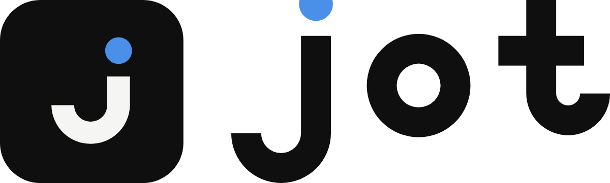

<p align="center">
  
</p>

# Guia de marca — Jot

Versão 1.0 · 18/10/2026

## A ideia

*Jot* vem de *iota*, a menor letra do alfabeto grego — "nem um jot ou til" são, literalmente,
as menores marcas que se pode escrever. A marca é o **j** cujo pingo (o *tittle*) é o herói:
a menor marca que ainda significa algo. É isso que o app faz — você registra uma coisa mínima,
e ela fica guardada.

O pingo azul é o átomo do sistema. Ele pode virar bullet de entrada, cursor, marcador de dia no
calendário, badge de tag. Tudo o mais é preto e silencioso, como a interface.

## Arquivos

```
brand/svg/                        vetores (fonte da verdade)
  jot-wordmark.svg                ← marca principal
  jot-symbol.svg                  ← o j isolado
  jot-icon.svg                    ← tile para dock, taskbar, favicon ≥48 px
  jot-icon-small.svg              ← corte para 16–32 px
  jot-icon-mono.svg               ← tile 1 cor, j vazado (transparente)
  jot-lockup-horizontal.svg       ← tile + logotipo
  jot-lockup-stacked.svg          ← tile sobre logotipo
  *-black / *-white / *-reverse   ← 1 cor, negativo, e versão para fundo escuro
brand/png/                        PNGs prontos (16–1024 px, 1200 px, jot.ico)
brand/apresentacao.html|.png      board de apresentação com mockups
brand/conceitos/                  os três conceitos da primeira rodada
```

Já instalados no app: `build/icon.ico`, `build/icon.png`, `public/logo.{ico,png,svg}`, `logo.png`.

## Versões e quando usar cada uma

| Versão | Uso |
|---|---|
| **Logotipo** `jot-wordmark` | Primeira opção sempre: README, site, cabeçalho, about, release notes |
| **Lockup horizontal** | Quando precisa de ícone + nome juntos (social preview, banner, apresentação) |
| **Lockup empilhado** | Espaços estreitos e verticais (splash, card quadrado) |
| **Tile** `jot-icon` | Dock, taskbar, tray, favicon, avatar — qualquer lugar que exige um quadrado |
| **Símbolo** `jot-symbol` | Marca d'água, loading, uso decorativo grande. Não use como ícone de app |
| **`-reverse`** | Sobre o preto da própria UI — as hastes são ~2% mais finas para compensar o brilho |
| **`-black` / `-white`** | 1 cor: gravação, impressão P&B, fundos coloridos, patrocínios |

## Cores

| | HEX | RGB | CMYK | Pantone (aprox.) |
|---|---|---|---|---|
| **Jot Ink** | `#0F0F0F` | 15 15 15 | 0 0 0 94 | Black 6 C |
| **Jot Blue** | `#4A8FE8` | 74 143 232 | 68 38 0 9 | 2727 C |
| **Paper** | `#F5F5F3` | 245 245 243 | 0 0 1 4 | — |

`#4A8FE8` é o mesmo `--c-accent` que a UI já usa — a marca e o produto falam a mesma língua.

Contraste: azul sobre ink = **6,4:1** ✓; azul sobre paper = **3,2:1** — suficiente para o pingo
(elemento gráfico, mínimo 3:1), insuficiente para texto pequeno. Nunca use o azul para corpo de
texto sobre fundo claro.

**A marca tem que funcionar sem o azul.** Se houver qualquer dúvida de reprodução, use a versão
`-black` ou `-white`.

## Área de respiro e tamanhos mínimos

A unidade de medida é o **pingo** (o diâmetro do tittle).

- **Respiro:** 1 pingo livre em volta de todo o conjunto. Nada de texto, borda ou imagem dentro disso.
- **Tamanho mínimo:**

| Elemento | Mínimo | Observação |
|---|---|---|
| Logotipo | 72 px de largura (20 mm) | abaixo disso o vão do pingo fecha |
| Tile / favicon | 16 px | **obrigatoriamente** `jot-icon-small.svg` abaixo de 48 px |
| Símbolo isolado | 24 px | use `jot-symbol-small.svg` abaixo de 48 px |

O corte pequeno não é o mesmo desenho reduzido: ele tem haste mais grossa, contraforma mais aberta
e vão maior entre pingo e haste. Usar o desenho grande a 16 px vira uma mancha.

## Fundos aprovados

- Paper `#F5F5F3`, branco, e cinzas até ~`#E0E0E0` → versão colorida ou `-black`
- Ink `#0F0F0F` e pretos até ~`#2A2A2A` → `-reverse` ou `-white`
- Fotos e fundos de médio contraste → `-white` com o conjunto inteiro em uma cor
- Fundo azul `#4A8FE8` → apenas `-white`

## Uso indevido

Não:

1. Trocar a cor do pingo por outra que não seja Jot Blue (ou a cor única da versão mono).
2. Mudar a distância entre o pingo e a haste, ou "colar" os dois.
3. Girar, inclinar, espelhar ou esticar (sempre escala proporcional).
4. Aplicar sombra, brilho, gradiente, contorno ou textura.
5. Redesenhar o logotipo com uma fonte qualquer — as letras são traçados, não texto.
6. Usar o desenho grande abaixo de 48 px (existe o corte pequeno para isso).
7. Colocar a versão colorida sobre fundo de contraste médio, onde o azul some.
8. Reintroduzir o mascote junto da marca. A história do esquilo vive no texto, não no logo.

## Tipografia

O logotipo é **desenhado**, não escrito: todas as letras são traçados vetoriais construídos com
a mesma geometria do símbolo (uma espessura, arcos exatos, pingo = 1,18 × a espessura da haste).
Nenhuma fonte foi usada no arquivo final — não há licença a respeitar e nada a reinstalar.

Para texto ao redor da marca, use o que o app já carrega:

| Função | Fonte |
|---|---|
| Títulos | Playfair Display |
| Interface e corpo | Lora |
| Código, atalhos, timestamps | JetBrains Mono |

## Construção

Símbolo em grade de 256: haste 44, raio externo do gancho 76, raio interno 32 (contraforma 64),
pingo r = 26 com vão de 24 até o topo da haste. Todos os arcos são círculos exatos; não há
curvas livres no símbolo. O conjunto é centrado opticamente (centro em y = 126, não 128).

## Pendências

- **Busca de marca registrada não foi feita.** Um `j` geométrico é uma forma comum; antes de
  qualquer uso comercial ou registro, faça uma busca profissional (INPI, EUIPO, USPTO) e uma
  busca reversa de imagem.
- Masters em PDF/EPS podem ser gerados a partir dos SVGs se você precisar mandar para gráfica.
